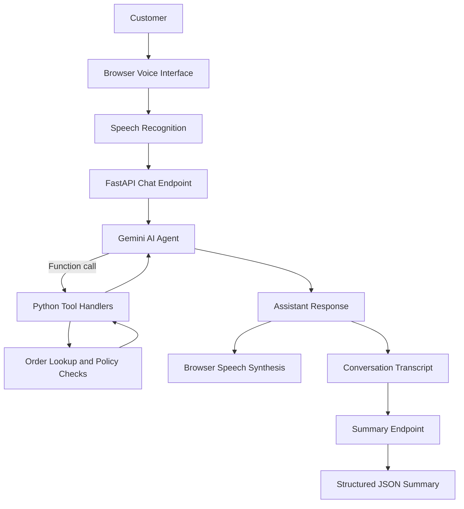

# Aura Skincare — Aria AI Voice Support Agent

Aria is a browser-based AI voice customer support agent built for the DataStraw Technologies AI & Tech Intern assessment. It helps customers with order tracking, return eligibility, cancellations, and skincare-store policies through a conversational voice interface.

The application uses FastAPI, Google's Gemini API, browser speech recognition and speech synthesis, and Python-based policy checks. It also generates a chronological conversation transcript and a structured JSON call summary.

## Features

- **Voice interaction:** Speak with Aria through browser speech recognition and speech synthesis.
- **LLM function calling:** Connects the language model to structured order and policy tools.
- **Order tracking:** Retrieves mock order details, courier information, and delivery estimates.
- **Policy enforcement:** Validates return eligibility, shipping charges, and cancellation rules in Python.
- **Safe cancellation:** Rechecks order status on the server before allowing cancellation.
- **Conversation context:** Sends conversation history so Aria can understand follow-up questions.
- **Call summary:** Generates structured fields for customer intent, order ID, resolution status, and call summary.
- **Test orders:** Includes sample orders for demonstrating different customer support scenarios.
- **Fallback handling:** Provides graceful handling for unsupported requests and unavailable AI responses.

## Technology Stack

| Component | Technology |
|---|---|
| Backend | Python, FastAPI |
| AI model | Google Gemini API |
| Function calling | Gemini tool/function calling |
| Frontend | HTML, CSS, JavaScript |
| Speech input | Browser SpeechRecognition |
| Speech output | Browser SpeechSynthesis |
| Data | JSON-based mock orders |
| Testing | pytest |
| Deployment | Render or Docker |

## Architecture



### Project Structure

```text
auraskin-voice-agent/
├── app/
│   ├── main.py
│   ├── agent.py
│   ├── orders.py
│   ├── policies.py
│   ├── summarizer.py
│   └── static/
├── data/
│   └── orders.json
├── tests/
├── .env.example
├── .gitignore
├── Dockerfile
├── render.yaml
├── requirements.txt
└── README.md
```

- `app/main.py` — FastAPI application and API endpoints.
- `app/agent.py` — AI instructions, tool definitions, and function-calling flow.
- `app/orders.py` — Mock order retrieval and in-memory order state.
- `app/policies.py` — Deterministic business rules and eligibility checks.
- `app/summarizer.py` — Structured call-summary generation and fallback handling.
- `app/static/` — Browser interface and voice interaction logic.
- `data/orders.json` — Sample order records.
- `tests/` — Automated tests.

## Business Rules

Aria uses the following rules for the assessment's fictional Aura Skincare store:

| Policy | Rule |
|---|---|
| Shipping | Free above ₹499; ₹50 below ₹499 |
| Delivery | Standard delivery in 3–5 business days |
| Exactly ₹499 | The policy does not specify the shipping charge |
| Returns | Within 7 days of delivery for unopened and unused products in original packaging |
| Damaged or defective items | Report within 48 hours and provide photos; replacement is subject to review |
| Cancellation | Allowed only while an order is in `Processing` status |
| Shipped orders | Cannot be cancelled through the agent; customers may refuse delivery at the doorstep |
| Cash on Delivery | Up to and including ₹2,500, payable by cash or UPI |

Policy enforcement is performed in Python rather than relying only on the language model's instructions. The cancellation handler checks the current order status before changing it. Aria should not claim that an order was cancelled unless the tool confirms success.

## Sample Orders

| Order ID | Product | Amount | Initial status |
|---|---|---:|---|
| ORD-101 | Vitamin C Serum 30ml | ₹699 | Out for Delivery |
| ORD-102 | Hydrating Sunscreen SPF 50 | ₹499 | Delivered |
| ORD-103 | Green Tea Face Wash + Toner | ₹850 | Processing |

These are fictional demonstration records, not live customer or courier data. Delivery estimates and order states are provided for testing the agent.

## Getting Started

### Prerequisites

- Python 3.10 or a compatible version supported by the dependencies.
- A Google Gemini API key for AI responses.
- A recent version of Google Chrome or Microsoft Edge for the best speech API compatibility.

### 1. Clone the repository

```bash
git clone <YOUR_GITHUB_REPOSITORY_URL>
cd auraskin-voice-agent
```

Replace the placeholder URL with your repository URL after publishing the project.

### 2. Create a virtual environment

**Windows PowerShell:**

```powershell
python -m venv .venv
.\.venv\Scripts\Activate.ps1
```

**Linux or macOS:**

```bash
python -m venv .venv
source .venv/bin/activate
```

### 3. Install dependencies

```bash
python -m pip install -r requirements.txt
```

### 4. Configure environment variables

Create a local `.env` file using `.env.example` as a template. On Windows PowerShell:

```powershell
Copy-Item .env.example .env
```

Set your Gemini API key in `.env`:

```dotenv
GEMINI_API_KEY=your_gemini_api_key
GEMINI_MODEL=gemini-flash-lite-latest
```

Use the model configured and tested for your environment. `GEMINI_MODEL` is optional if the application already defines a working default.

**Security:** Never commit `.env` or publish your API key. Configure production secrets through your hosting provider's environment-variable settings.

### 5. Run the application

```powershell
uvicorn app.main:app --reload
```

Open `http://127.0.0.1:8000` in Chrome or Edge.

### 6. Run tests

```powershell
python -m pytest
```

Tests that use a mocked AI client may run without a Gemini API key. Live AI behavior should also be tested separately with a valid key.

## API Endpoints

| Method | Endpoint | Purpose |
|---|---|---|
| GET | `/api/health` | Health check |
| GET | `/api/orders` | Retrieve sample orders |
| POST | `/api/chat` | Send a message and conversation history |
| POST | `/api/summary` | Generate a structured call summary |
| POST | `/api/reset` | Restore the mock order state |

### Chat request

The chat endpoint accepts a message and conversation history. The exact request and response schema should be confirmed against `app/main.py`.

Conceptual request:

```json
{
  "message": "Where is my order ORD-101?",
  "history": []
}
```

### Call summary

The summary endpoint accepts the conversation transcript and tool events. Its structured output contains:

```json
{
  "customer_intent": "ORDER_TRACKING",
  "order_id": "ORD-101",
  "resolution_status": "RESOLVED",
  "call_summary": "The customer asked about the delivery status of ORD-101."
}
```

The example above illustrates the output structure; the actual values depend on the conversation.

## Function Calling

The agent uses tools to retrieve order information and perform controlled actions:

- `get_order_details(order_id)` — Retrieves the matching mock order and applicable policy information.
- `check_return_eligibility(...)` — Checks return eligibility against the store's rules.
- `cancel_order(order_id)` — Attempts cancellation only when the current order status allows it.

The intended flow is:

1. The customer asks a question.
2. The model determines whether a tool is needed.
3. The backend executes the requested tool.
4. The result is returned to the model.
5. Aria communicates the result to the customer.

Business-critical checks remain on the backend so that a natural-language request cannot bypass the implemented cancellation rules.

## Demo Scenarios

Use these scenarios to demonstrate the project:

1. **Order tracking:** Ask, “Where is my order ORD-101?” Confirm the status, courier, and configured delivery estimate.
2. **Return eligibility:** Ask about returning ORD-102, which is outside the seven-day return window in the sample data.
3. **Successful cancellation:** Ask to cancel ORD-103 while it is in `Processing`.
4. **Rejected cancellation:** Attempt to cancel ORD-101 while it is `Out for Delivery`.
5. **Policy questions:** Ask about shipping charges, COD limits, and damaged products.
6. **Out-of-scope request:** Ask Aria to book a flight and verify that it politely redirects the customer to relevant support.
7. **End call:** Review the transcript and structured summary.

## Limitations

- Browser speech recognition and speech synthesis depend on browser support, installed voices, and microphone permissions.
- The interface is designed primarily for Chrome and Edge; speech recognition may not be available in every browser.
- The current interaction uses turn-taking rather than full-duplex, real-time voice streaming.
- Orders are mock records and are not connected to a real order-management system or courier API.
- Order state is stored in memory. Changes can persist across new conversations during the same server process, but restarting the server restores the initial mock data.
- Production use would require persistent storage, authentication, customer verification, monitoring, and additional security controls.
- Live model behavior depends on a valid API key, network availability, model availability, and provider limits.

## Deployment

The repository includes `render.yaml` and a `Dockerfile` for deployment.

### Render

1. Push the project to GitHub.
2. Create a new Render Web Service and connect the repository.
3. Review the build and start commands in `render.yaml`.
4. Add `GEMINI_API_KEY` and any required model configuration as environment variables.
5. Deploy and test the public HTTPS URL, including microphone permissions and API endpoints.

Do not place secrets in the repository or hardcode them in the deployment configuration.

### Docker

Build the image:

```bash
docker build -t aria-voice-agent .
```

Run it with your API key supplied through the environment:

```bash
docker run --rm -p 8000:8000 -e GEMINI_API_KEY=your_gemini_api_key aria-voice-agent
```

Check the Dockerfile's configured port and start command if you change the deployment configuration.

## Assessment Discussion

### 1. Why this architecture?

The browser handles speech input and output, while FastAPI manages AI requests, tools, and business rules. This keeps the backend modular and allows policy checks to be tested independently. The trade-off is that browser speech quality, availability, and latency vary by device and browser.

### 2. What was the hardest engineering challenge?

A key challenge was separating conversational flexibility from policy enforcement. Prompt instructions alone are not a reliable way to enforce cancellation and return rules, so the application performs these checks in Python and uses the tool results to inform the response.

Voice turn-taking is another challenge because recognition must be coordinated with thinking and speech output to reduce accidental capture of the agent's own voice.

### 3. What would you improve with one more week?

- Add streaming responses and evaluate server-side speech services.
- Improve latency, interruption handling, and support for Indian English and Hinglish.
- Add scripted evaluation conversations for policy compliance and tool-call correctness.
- Improve observability and error handling.

### 4. How would you scale to 1,000 calls per day?

- Store orders, sessions, and call logs in a persistent database.
- Integrate with a real order-management API and verify customer identity.
- Add authentication, rate limiting, timeouts, retries, and monitoring.
- Use appropriate session storage, such as Redis, if required by the deployment architecture.
- Track latency, token usage, tool errors, and service costs.
- Provide human handoff and define transcript retention and privacy policies.

## Author

**Harshit Temkar**

GitHub: [harshit-temkar7-ds](https://github.com/harshit-temkar7-ds)

Project: Aria AI Voice Support Agent — DataStraw Technologies assessment.
